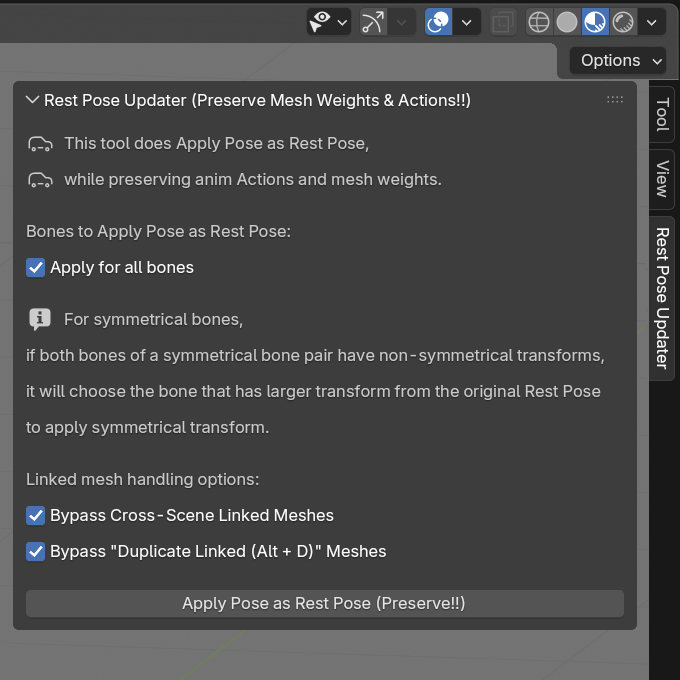

# blender-rest-pose-updater

## About

Auto-detects modified pose bones, mirrors them for symmetric bones, then does Apply Pose to Rest Pose, preserving mesh weights, mesh mirror seams, and animation Actions. 

Mostly written with google ai search mode, for personal use on Blender 4.5 LTS. 
This may or may not work on any Blender 4.0+ versions

Maybe it's just my skill issue, but many such cases where I make a model, rig it, and rapidly iterate making animations, but then I realize the default pose is bad. Or needs to be changed. Or some bones (like item bones) need to be oriented in a specific way. 
If you just *Apply Pose to Rest Pose*, the mesh and existing animation Actions all distort badly and you need to go through each bone and mesh duplicating modifiers and adding copy transform constraints... when I just want to modify the default pose just a tweak. I felt like this shouldn't be such a hassle or prone to user error to do

Not sure if this works for Shape keys or Bendy bones, because I don't use them and haven't tested for those. 
Maybe those are covered in other github repos that handles *Apply Pose as Rest Pose*?

## NOTE

I will likely not maintain this, **I will likely not add more options nor be able fix issues if they arise on other users.** 
**Always keep backups, if used on important project files, or test on a separate `.blend` file first.**

This repository is mainly for personal documenting and referencing purposes.

## Preview

